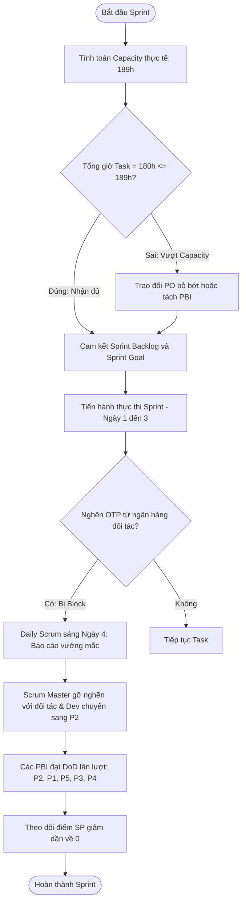

# [Thực hành 2] Phân rã Task kỹ thuật, Tính Capacity & Theo dõi Burndown Chart

> 👤 **Học viên:** Đỗ Hoàng Sơn | **Mã SV:** PTIT-HCM-066
> 🏫 **Môn học:** IT206-K25-Agile-va-Scrum

---

## 📊 Sơ đồ thiết kế hệ thống (Activity Diagram)

> 💡 *Sơ đồ dưới đây được render tự động trực tiếp trên GitHub bằng Mermaid. Bạn cũng có thể tải file **`btth2.drawio`** trong repository này để mở và chỉnh sửa trực tiếp trên [Draw.io (diagrams.net)](https://app.diagrams.net).* 

---

## Nhiệm vụ 1: Phân rã Task kỹ thuật User Story nạp tiền

Tôi tiến hành phân rã User Story 'Là khách hàng, tôi muốn nạp tiền vào ví GoFood qua thẻ tín dụng quốc tế' (5 Story Points) thành các Task kỹ thuật cụ thể. Mỗi Task bắt đầu bằng một động từ mạnh, có đầu ra kiểm chứng được và tuân thủ tuyệt đối Definition of Done (DoD) của đội.

- Task 1: Thiết kế màn hình nhập thẻ (4 giờ) - Đầu ra kiểm chứng được: Giao diện UI hoàn thiện, hỗ trợ nhập thông tin thẻ, validated các trường dữ liệu cơ bản.
- Task 2: Viết chức năng nạp tiền phía máy chủ gọi cổng ngân hàng (8 giờ) - Đầu ra kiểm chứng được: API kết nối cổng thanh toán quốc tế hoạt động ổn định, xử lý được mã phản hồi trả về.
- Task 3: Mã hóa thông tin thẻ, không lưu số thẻ (5 giờ) - Đầu ra kiểm chứng được: Dữ liệu thẻ nhạy cảm được mã hóa chuẩn bảo mật PCI-DSS, không lưu trữ thông tin số thẻ trên cơ sở dữ liệu nội bộ.
- Task 4: Viết và chạy kiểm thử trường hợp nạp thành công, thẻ bị từ chối, timeout (6 giờ) - Đầu ra kiểm chứng được: Bộ test cases đạt 100% test pass, kiểm thử thành công kịch bản thẻ bị từ chối giao dịch.
- Task 5: Review code và đưa lên môi trường thử nghiệm (3 giờ) - Đầu ra kiểm chứng được: Code đã được ít nhất một lập trình viên khác review, pull request được merge và deploy thành công lên môi trường Staging.

## Nhiệm vụ 2: Tính toán Capacity thực tế và Đối chiếu Sprint Backlog

Để đảm bảo lập kế hoạch sát thực tế, tôi tiến hành tính toán năng lực làm việc thực tế của Scrum Team dựa trên số liệu ngày khả dụng, giờ tập trung, việc cố định và khoảng dự phòng (Buffer).

Công thức áp dụng: Capacity thực tế = Σ(Ngày khả dụng × Giờ tập trung) − Việc cố định − Buffer

- Tổng giờ tập trung của 4 thành viên (Nam: 10, Thảo: 10, Quân: 10, Hương: 7 ngày khả dụng): (10 + 10 + 10 + 7) × 6 = 37 × 6 = 222 giờ.
- Trừ việc cố định (buổi demo với ngân hàng đối tác cả team mất 12 giờ): 222 - 12 = 210 giờ.
- Tính khoảng dự phòng Buffer 10% trên số giờ còn lại: 210 × 10% = 21 giờ.
- Capacity thực tế của Scrum Team: 210 - 21 = 189 giờ.
- Tổng giờ Task của Sprint Backlog: P1 (26 giờ) + P2 (34 giờ) + P3 (58 giờ) + P4 (44 giờ) + P5 (18 giờ) = 180 giờ.
- Đối chiếu: Tổng giờ Task (180 giờ) <= Capacity thực tế (189 giờ), do đó team hoàn toàn nhận đủ Sprint Backlog mà không sợ bị quá tải. Lưu ý không quy đổi Story Point sang giờ một cách máy móc vì các PBI có độ phức tạp kỹ thuật khác nhau (ví dụ P2 và P4 đều 5 SP nhưng tốn số giờ thực hiện chênh lệch).

## Nhiệm vụ 3: Lập bảng dữ liệu và Phân tích Burndown Chart

Dưới đây là bảng số liệu chi tiết từ Ngày 0 đến Ngày 10 ghi nhận lượng điểm Story Points còn lại theo Đường lý tưởng (Ideal Line) và Đường thực tế (Actual Line).

| Ngày làm việc | Đường lý tưởng (Ideal Line) | Đường thực tế (Actual Line) | Trạng thái ghi chú |
| --- | --- | --- | --- |
| Ngày 0 | 25.0 pt | 25 pt | Khởi động Sprint |
| Ngày 1 | 22.5 pt | 25 pt | Bị nghẽn xác thực OTP của đối tác (đường đi ngang) |
| Ngày 2 | 20.0 pt | 25 pt | Vẫn bị nghẽn (đường đi ngang) |
| Ngày 3 | 17.5 pt | 25 pt | Vẫn bị nghẽn, cao hơn đường lý tưởng 7,5 pt |
| Ngày 4 | 15.0 pt | 20 pt | P2 đạt DoD (giảm 5 pt) |
| Ngày 5 | 12.5 pt | 20 pt | Đang làm dở P1, P3; chưa PBI nào đạt DoD (đi ngang) |
| Ngày 6 | 10.0 pt | 15 pt | P1 đạt DoD (giảm 5 pt) |
| Ngày 7 | 7.5 pt | 13 pt | P5 đạt DoD (giảm 2 pt) |
| Ngày 8 | 5.0 pt | 13 pt | Đang làm dở P3, P4 (đi ngang) |
| Ngày 9 | 2.5 pt | 5 pt | P3 đạt DoD (giảm 8 pt) |
| Ngày 10 | 0.0 pt | 0 pt | P4 đạt DoD, hoàn thành toàn bộ Sprint Backlog |

## Phân tích và Đề xuất hành động từ Burndown Chart

Từ biểu đồ Burndown Chart và dữ liệu thực tế diễn ra trong Sprint, tôi rút ra các kết luận kỹ thuật và hướng xử lý sau:

- Hiện tượng đi ngang từ Ngày 1 đến Ngày 3: Đường thực tế đi ngang ở mốc 25 points báo hiệu tình trạng nghẽn hệ thống nghiêm trọng (Blocker) do lỗi xác thực OTP từ phía ngân hàng đối tác, khiến chưa có PBI nào hoàn thành đạt chuẩn DoD.
- Nguyên nhân ngày 5 và ngày 8 đi ngang: Mặc dù các lập trình viên vẫn làm việc chăm chỉ, nhưng theo nguyên lý Agile Scrum, Burndown Chart tính điểm dựa trên Story Point hoàn thành khi PBI đạt chuẩn DoD. Do các PBI này chưa kết thúc trọn vẹn nên điểm số trên biểu đồ chưa thể sụt giảm.
- Hành động đề xuất tại Daily Scrum sáng Ngày 4: Scrum Master cần nhanh chóng nắm bắt thông tin, phối hợp với các bên liên quan để gỡ nghẽn cổng kết nối với ngân hàng đối tác. Trong thời gian chờ đợi, các lập trình viên nên tạm gác các Task phụ thuộc API ngân hàng để chuyển sang thực hiện các PBI độc lập (như P2 xem số dư và lịch sử ví). Nếu rủi ro trễ tiến độ kéo dài, team cần ngồi lại trao đổi với Product Owner về việc điều chỉnh phạm vi (scope), nhưng kiên quyết bảo vệ Sprint Goal.

---

## 📁 Danh sách tệp tin nộp bài trong Repository
- 📝 `btth2.docx`: Báo cáo tài liệu phân tích nghiệp vụ hoàn chỉnh.
- 🎨 `btth2.drawio`: File thiết kế sơ đồ chuẩn theo quy định đề bài (mở trực tiếp bằng [Draw.io](https://app.diagrams.net) hoặc Lucidchart).
