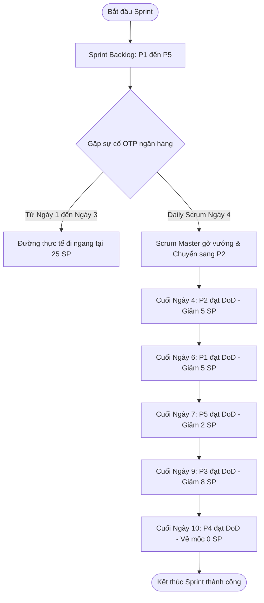

# [Thực hành 2] Phân rã Task kỹ thuật, Tính Capacity & Theo dõi Burndown Chart

> 👤 **Học viên:** Đỗ Hoàng Sơn | **Mã SV:** PTIT-HCM-066
> 🏫 **Môn học:** IT206-K25-Agile-va-Scrum

---

## 📊 Sơ đồ thiết kế hệ thống (Activity Diagram)

> 💡 *Sơ đồ dưới đây được render tự động trực tiếp trên GitHub bằng Mermaid. Bạn cũng có thể tải file **`btth2.drawio`** trong repository này để mở và chỉnh sửa trực tiếp trên [Draw.io (diagrams.net)](https://app.diagrams.net).* 

---

## Nhiệm vụ 1: Phân rã User Story thành Task kỹ thuật (P1)

Mình tiến hành phân rã User Story 'Là khách hàng, tôi muốn nạp tiền vào ví GoFood qua thẻ tín dụng quốc tế' (5 Story Points) thành các Task kỹ thuật cụ thể. Mỗi Task đều bắt đầu bằng động từ hành động, có đầu ra kiểm chứng được và tổng thời gian ước lượng hoàn toàn đáp ứng Definition of Done (DoD) của đội.

- Thiết kế giao diện nhập thẻ – 4 giờ (Đầu ra: Màn hình UI nhập số thẻ, ngày hết hạn, mã CVV chạy được trên môi trường dev)
- Viết chức năng nạp tiền phía máy chủ gọi cổng ngân hàng – 8 giờ (Đầu ra: API backend xử lý giao dịch kết nối thành công với Sandbox ngân hàng)
- Mã hóa thông tin thẻ, không lưu số thẻ – 5 giờ (Đầu ra: Module bảo mật mã hóa dữ liệu nhạy cảm theo chuẩn PCI-DSS)
- Viết và chạy kiểm thử (nạp thành công, thẻ bị từ chối, quá thời gian chờ) – 6 giờ (Đầu ra: Bộ test cases Automation/Manual đạt 100% các kịch bản kiểm thử)
- Review code và đưa lên môi trường thử nghiệm – 3 giờ (Đầu ra: Pull Request được đồng nghiệp review approved và deploy thành công lên Staging)

## Nhiệm vụ 2: Tính toán Capacity thực tế và Đối chiếu Sprint Backlog

Dựa trên thông số nhân sự và thời gian làm việc thực tế của Scrum Team trong Sprint 10 ngày, mình tính toán sức chứa thực tế (Capacity) như sau:

Tổng giờ tập trung của 4 thành viên (Nam 10 ngày, Thảo 10 ngày, Quân 10 ngày, Hương 7 ngày do nghỉ phép 3 ngày) với định mức 6 giờ/ngày/người: (10 + 10 + 10 + 7) x 6 = 37 x 6 = 222 giờ.

Trừ đi thời gian việc cố định (buổi demo với ngân hàng đối tác cả team mất 12 giờ): 222 - 12 = 210 giờ.

Trừ tiếp khoản dự phòng Buffer 10% trên số giờ còn lại: 210 x 10% = 21 giờ.

Sức chứa thực tế (Capacity) của Scrum Team: 210 - 21 = 189 giờ.

- Tổng giờ Task của Sprint Backlog: P1 (26 giờ) + P2 (34 giờ) + P3 (58 giờ) + P4 (44 giờ) + P5 (18 giờ) = 180 giờ.
- Đối chiếu với Capacity: Tổng giờ Task (180 giờ) <= Capacity thực tế (189 giờ). Do đó, team hoàn toàn tự tin nhận đủ Sprint Backlog.
- Nguyên tắc Scrum: Không quy đổi Story Point cứng nhắc ra giờ (ví dụ P2 và P4 đều 5 SP nhưng tốn số giờ khác nhau lần lượt là 34 giờ và 44 giờ do độ phức tạp kỹ thuật).

## Nhiệm vụ 3: Lập bảng dữ liệu Burndown Chart và Phân tích tiến độ

Dưới đây là bảng số liệu chi tiết từ Ngày 0 đến Ngày 10 ghi nhận đường lý tưởng (Ideal Line) và đường thực tế (Actual Line) của Sprint:

- Ngày 1 đến Ngày 3 đường thực tế đi ngang ở mốc 25 points: Cảnh báo công việc bị tắc nghẽn nghiêm trọng (Blocker) do lỗi hệ thống OTP từ ngân hàng đối tác.
- Ngày 5 và Ngày 8 đường thực tế tiếp tục đi ngang dù team vẫn làm việc: Do bản chất Burndown Chart tính theo Story Point chỉ giảm xuống khi một Product Backlog Item (PBI) hoàn thành đạt 100% Definition of Done (DoD), các Task đang làm dở chưa được tính điểm.
- Đề xuất cho Daily Scrum sáng Ngày 4: Scrum Master cần nhanh chóng phối hợp với bên ngân hàng đối tác để gỡ nghẽn kỹ thuật; trong lúc chờ đợi, Developers nên chuyển hướng sang làm các PBI không bị phụ thuộc vào cổng thẻ (như P2 Xem số dư và lịch sử ví). Nếu có nguy cơ trễ hạn bàn giao, cần thảo luận sớm với Product Owner về việc điều chỉnh phạm vi nhưng tuyệt đối phải giữ vững Sprint Goal.

| Ngày làm việc | Đường lý tưởng (Ideal Line) | Đường thực tế (Actual Line) | Trạng thái ghi chú |
| --- | --- | --- | --- |
| Ngày 0 | 25.0 pt | 25 pt | Khởi động Sprint |
| Ngày 1 | 22.5 pt | 25 pt | Bị nghẽn xác thực OTP của đối tác (đường đi ngang) |
| Ngày 2 | 20.0 pt | 25 pt | Vẫn bị nghẽn (đường đi ngang) |
| Ngày 3 | 17.5 pt | 25 pt | Vẫn bị nghẽn, cao hơn đường lý tưởng 7.5 pt |
| Ngày 4 | 15.0 pt | 20 pt | P2 đạt DoD (giảm 5 pt) |
| Ngày 5 | 12.5 pt | 20 pt | Đang làm dở P1, P3; chưa PBI nào đạt DoD (đi ngang) |
| Ngày 6 | 10.0 pt | 15 pt | P1 đạt DoD (giảm 5 pt) |
| Ngày 7 | 7.5 pt | 13 pt | P5 đạt DoD (giảm 2 pt) |
| Ngày 8 | 5.0 pt | 13 pt | Đang làm dở P3, P4 (đi ngang) |
| Ngày 9 | 2.5 pt | 5 pt | P3 đạt DoD (giảm 8 pt) |
| Ngày 10 | 0.0 pt | 0 pt | P4 đạt DoD, hoàn thành toàn bộ Sprint Backlog |

---

## 📁 Danh sách tệp tin nộp bài trong Repository
- 📝 `btth2.docx`: Báo cáo tài liệu phân tích nghiệp vụ hoàn chỉnh.
- 🎨 `btth2.drawio`: File thiết kế sơ đồ chuẩn theo quy định đề bài (mở trực tiếp bằng [Draw.io](https://app.diagrams.net) hoặc Lucidchart).
